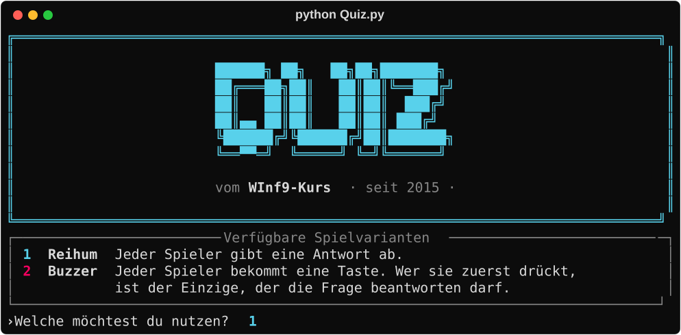
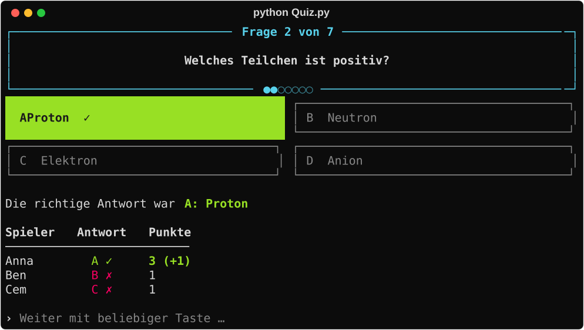
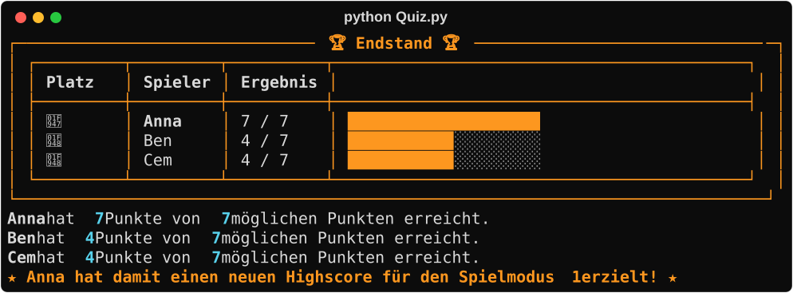

# quiz

Dies ist das Quiz vom WInf9-Kurs.

<p align="center">
  
</p>

Ein Quiz für das Terminal mit sieben handverlesenen Fragen aus dem Jahr 2015 und zwei Spielvarianten. Gebaut im Informatikunterricht, um Python und Git zu lernen. Elf Jahre später endlich so, dass man es auch spielen kann.

## Spielvarianten

| | Variante | So geht's |
|---|---|---|
| **1** | **Reihum** | Jeder Spieler gibt eine Antwort ab. |
| **2** | **Buzzer** | Jeder Spieler bekommt eine Taste zugewiesen. Drückt er diese, ist er der Einzige, der die Frage beantworten darf. |

Im Buzzer-Modus reicht jetzt wirklich *eine* Taste. Enter muss man nicht mehr drücken. Weiß keiner die Antwort, geht es mit <kbd>⏎</kbd> weiter.

<p align="center">
  
</p>

## Installieren & spielen

Du brauchst Python 3.9 oder neuer.

```sh
git clone https://github.com/WInf9FH/quiz.git
cd quiz
pip install -e .

quiz                # oder ganz klassisch:
python Quiz.py
```

Optionen:

```text
quiz --variante 2           Spielvariante direkt wählen
quiz --mischen              Fragen in zufälliger Reihenfolge
quiz --fragen meine.json    eigene Fragen spielen
quiz --highscores pfad.json Highscores woanders speichern (Standard: ~/.winf9-quiz/)
```

<p align="center">
  
</p>

## Eigene Fragen

Fragen sind eine JSON-Liste. Vier Antworten, eine davon ist richtig:

```json
[
  {
    "frage": "Wie heißt die Hauptstadt von Deutschland?",
    "antworten": ["Bonn", "Hamburg", "Berlin", "München"],
    "richtig": "C"
  }
]
```

Die eingebauten Fragen liegen in [`winf9quiz/data/fragen.json`](winf9quiz/data/fragen.json). Sie sind auf dem Stand von 2015 und wurden bewusst nicht aktualisiert. Deutschland hat inzwischen eher 84 als 82 Millionen Einwohner, aber „82 Mio.“ ist immer noch die beste der vier Antworten.

## Entwickeln

```sh
pip install -e ".[dev]"
pytest
ruff check . && ruff format --check .
```

```text
Quiz.py              # Startskript, wie früher
winf9quiz/
├── app.py           # Kommandozeile & Spielablauf
├── spiel.py         # Spielregeln (Reihum, Buzzer, Rangliste)
├── fragen.py        # Fragen laden und prüfen
├── highscore.py     # Bestenliste pro Spielvariante
├── tasten.py        # eine Taste lesen, ohne Enter (Windows, Linux, macOS)
├── ui.py            # alles Bunte
└── data/fragen.json
```

## Mitwirkende

Der WInf9-Kurs, Frühjahr 2015: `WInf9FH`, `WInf9KR`, `WInf9BB`, `WInf9Kieran`, `WInf9Nl` und ein Account namens `Swag`.

## Lizenz

[GPL-2.0](LICENSE), wie schon immer.
